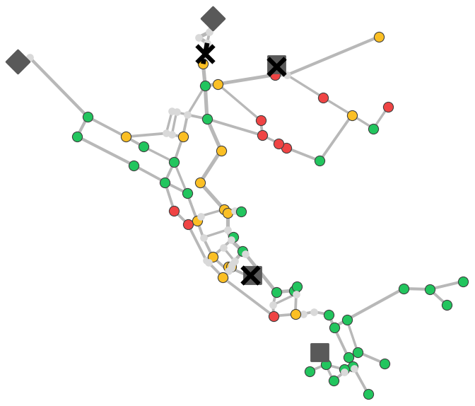
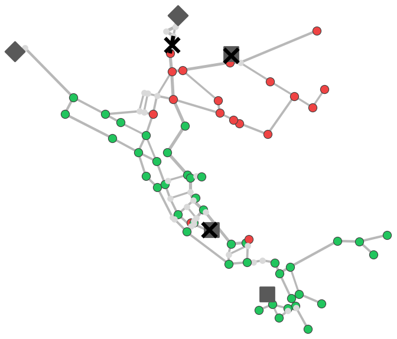
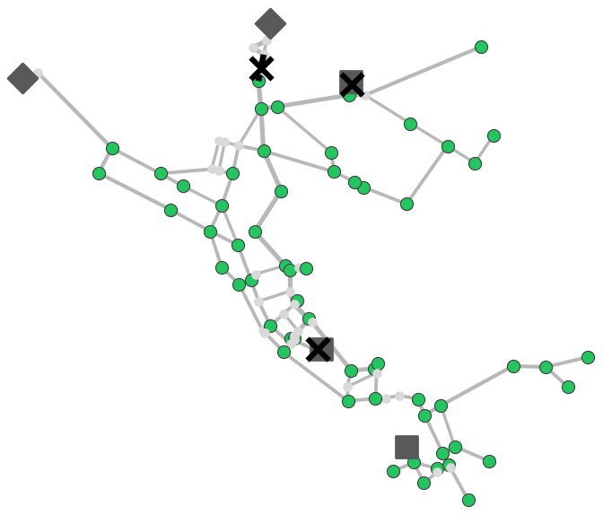

---
# CNA 2026 talk for FlowAllocationModuleForHydraulic.tex. Every number on these
# slides is copied from the main paper's Table 1 or the supplement (S2, S4, S8, S9);
# nothing is computed here. Colours are the brand ramps of docs/brand.md written as
# oklch, so the deck carries no hex literal. Render and export: see README.md.
pagetitle: "Composable Disservice Propagation (CNA 2026)"
lang: en
format:
  revealjs:
    width: 1280
    height: 720
    margin: 0.04
    center: false
    transition: none
    background-transition: none
    controls: false
    progress: false
    menu: false
    slide-number: c/t
    hash-type: number
    embed-resources: true
    pdf-max-pages-per-slide: 1
    include-in-header:
      - text: |
          <style>
          :root {
            --ink:       oklch(21% 0 0);
            --ink2:      oklch(44.2% 0 0);
            --muted:     oklch(55.2% 0 0);
            --line:      oklch(87.1% 0 0);
            --soft:      oklch(96.7% 0 0);
            --acc:       oklch(48.8% 0.079 210);
            --acc-mid:   oklch(80.9% 0.071 210);
            --acc-soft:  oklch(97% 0.01 210);
            --ok:        oklch(72.3% 0.171 150);
            --part:      oklch(76.9% 0.147 70);
            --fail:      oklch(57.7% 0.191 28);
          }
          html, body, .reveal, .reveal-viewport { background: white; }
          .reveal { font-family: Arial, Helvetica, sans-serif; color: var(--ink); }
          .reveal .slides section { font-size: 26px; line-height: 1.3; text-align: left; }
          .reveal .slides section h2 {
            font-family: Arial, Helvetica, sans-serif; font-size: 38px; font-weight: 700;
            color: var(--ink); line-height: 1.15; letter-spacing: -0.01em;
            margin: 0 0 22px 0; text-transform: none;
          }
          .reveal .slide-number { font-family: Arial, Helvetica, sans-serif; font-size: 16px;
            color: var(--muted); background: transparent; }
          .reveal svg text { font-family: Arial, Helvetica, sans-serif; }
          .reveal sub { font-size: 0.65em; vertical-align: -0.3em; }
          .acc { color: var(--acc); }
          .muted { color: var(--ink2); }
          .small { font-size: 22px; }

          /* SVG vocabulary shared by every diagram */
          .box      { fill: white; stroke: var(--ink); stroke-width: 2; }
          .box-acc  { fill: var(--acc-soft); stroke: var(--acc); stroke-width: 3; }
          .box-gt   { fill: var(--soft); stroke: var(--ink); stroke-width: 3; }
          .box-base { fill: white; stroke: var(--muted); stroke-width: 2; stroke-dasharray: 8 6; }
          .band     { fill: var(--soft); }
          .rule     { stroke: var(--line); stroke-width: 2; }
          .grid     { stroke: var(--line); stroke-width: 1.5; }
          .edge     { stroke: var(--ink2); stroke-width: 2.5; fill: none; }
          .edge-acc { stroke: var(--acc); stroke-width: 2.5; fill: none; }
          /* Mini CASCADE canvas on slide 4: edges and nodes take the functionality colour */
          .e-ok   { stroke: var(--ok); stroke-width: 2.5; fill: none; }
          .e-part { stroke: var(--part); stroke-width: 2.5; fill: none; }
          .e-fail { stroke: var(--fail); stroke-width: 2.5; fill: none; }
          .n-rim  { stroke: white; stroke-width: 2; }
          .canvas-dot { fill: var(--line); }
          .pipe     { stroke: var(--ink2); fill: none; stroke-linecap: round; }
          .head     { fill: var(--ink2); }
          .head-acc { fill: var(--acc); }
          .node     { fill: white; stroke: var(--ink); stroke-width: 2.5; }
          .src      { fill: var(--ink2); }
          .served   { fill: var(--acc-mid); }
          .bar-mod  { fill: var(--acc); }
          .bar-base { fill: var(--muted); }
          .stair    { stroke: var(--acc); stroke-width: 4; fill: none; }
          .floor    { stroke: var(--muted); stroke-width: 2; stroke-dasharray: 6 6; }
          .t      { font-size: 20px; fill: var(--ink); }
          .t-b    { font-size: 22px; font-weight: 700; fill: var(--ink); }
          .t-big  { font-size: 28px; font-weight: 700; fill: var(--ink); }
          .t-m    { font-size: 18px; fill: var(--ink2); }
          .t-tag  { font-size: 16px; font-weight: 700; letter-spacing: 0.08em; fill: var(--ink2); }
          .t-acc  { fill: var(--acc); }
          .c      { text-anchor: middle; }
          .e      { text-anchor: end; }

          /* Functionality glyphs: colour AND shape, so the PDF reads in greyscale */
          .g-ok   { fill: var(--ok); }
          .g-part { fill: var(--part); }
          .g-ring { fill: white; stroke: var(--part); stroke-width: 3; }
          .g-fail { fill: var(--fail); }
          .g-x    { stroke: white; stroke-width: 3; stroke-linecap: round; }
          .legend { display: flex; gap: 28px; align-items: center; font-size: 20px; color: var(--ink2); }
          .legend span { display: inline-flex; align-items: center; gap: 8px; }

          /* Title slide */
          .title-wrap { position: relative; height: 640px; }
          .logo { position: absolute; top: 0; right: 0; height: 160px; }
          .kicker { padding-top: 40px; font-size: 20px; font-weight: 700; letter-spacing: 0.06em;
            color: var(--acc); text-transform: uppercase; }
          .ptitle { margin-top: 100px; max-width: 1140px; font-size: 44px; font-weight: 700;
            line-height: 1.18; color: var(--ink); }
          .psub { margin-top: 30px; font-size: 30px; color: var(--acc); }
          .accent-rule { margin-top: 42px; width: 120px; height: 5px; background: var(--acc); }
          .authors { margin-top: 30px; font-size: 30px; font-weight: 700; }
          .affil { margin-top: 8px; font-size: 24px; color: var(--ink2); }

          /* Comparison panes and banners */
          .two-col { display: grid; grid-template-columns: 1fr 1fr; gap: 40px; }
          .pane { border-top: 5px solid var(--ink2); padding-top: 14px; }
          .pane-h { font-size: 30px; font-weight: 700; }
          .pane-eg { font-size: 19px; color: var(--ink2); margin: 4px 0 10px; }
          ul.pm { list-style: none; margin: 0; padding: 0; }
          ul.pm li { position: relative; padding-left: 36px; margin: 12px 0; font-size: 29px; }
          ul.pm li::before { position: absolute; left: 0; top: -2px; font-weight: 700; font-size: 30px; }
          ul.pm li.plus::before  { content: "+"; color: var(--acc); }
          ul.pm li.minus::before { content: "\2212"; color: var(--muted); }
          .banner { margin-top: 18px; padding: 14px 22px; border-left: 6px solid var(--ink);
            background: var(--soft); font-size: 28px; font-weight: 700; }
          .contrib { margin-top: 12px; padding: 14px 22px; border-left: 6px solid var(--acc);
            background: var(--acc-soft); font-size: 27px; }

          /* Slide 6 and 8 side columns */
          .side { display: grid; grid-template-columns: 820px 1fr; gap: 30px; align-items: start; }
          .side8 { display: grid; grid-template-columns: 760px 1fr; gap: 34px; align-items: start; }
          .rhs p { margin: 0 0 22px 0; font-size: 27px; }
          .chips { display: grid; grid-template-columns: repeat(3, 1fr); gap: 16px; margin-top: 44px; }
          .chip { border: 2px solid var(--line); padding: 12px 16px; font-size: 24px; }
          .chip b { display: block; font-size: 16px; letter-spacing: 0.06em; color: var(--ink2);
            text-transform: uppercase; margin-bottom: 4px; }

          /* Slide 5 */
          .steps { display: grid; grid-template-columns: 1fr 520px; gap: 30px; align-items: center; }
          .step { display: grid; grid-template-columns: 60px 1fr; margin-bottom: 46px; }
          .step .n { font-size: 38px; font-weight: 700; color: var(--acc); }
          .step .h { font-size: 34px; font-weight: 700; }
          .step .d { font-size: 30px; color: var(--ink); margin-top: 4px; }
          .formula { font-size: 32px; margin-top: 6px; }

          /* Slide 7 */
          .nets { font-size: 24px; margin: 10px 0 16px; }
          .fam { display: grid; grid-template-columns: repeat(4, 1fr); gap: 16px; }
          .fam div { border-top: 4px solid var(--ink2); padding-top: 8px; font-size: 21px; color: var(--ink2); }
          .fam b { display: block; font-size: 25px; color: var(--ink); }

          /* Slide 8 */
          .callout { border-top: 4px solid var(--ink2); padding-top: 8px; margin-bottom: 26px; }
          .callout .h { font-size: 22px; font-weight: 700; }
          .callout .row { display: grid; grid-template-columns: 120px 1fr; align-items: baseline; }
          .callout .num { font-size: 50px; font-weight: 700; line-height: 1.1; }
          .callout .lab { font-size: 20px; color: var(--ink2); }
          .num.base { color: var(--muted); }
          .num.mod  { color: var(--acc); }
          .swatch { display: inline-block; width: 22px; height: 16px; border-radius: 3px; }

          /* Slide 9 */
          .fig9 { display: block; width: 1120px; margin: 0 auto; }
          .cap9 { font-size: 21px; color: var(--ink2); text-align: center; margin: 2px 0 12px; }
          .row9 { display: grid; grid-template-columns: 640px 1fr; gap: 30px; align-items: start; }
          table.pr { border-collapse: collapse; font-size: 25px; }
          table.pr th, table.pr td { padding: 5px 12px; text-align: right; border-bottom: 1px solid var(--line); }
          table.pr th:first-child, table.pr td:first-child { text-align: left; }
          table.pr th { font-size: 18px; color: var(--ink2); font-weight: 700; }
          table.pr td.avg, table.pr th.avg { border-left: 2px solid var(--line); font-weight: 700; }
          .note9 p { margin: 0 0 14px; font-size: 25px; }

          /* Slide 10 */
          .est { display: grid; grid-template-columns: 1fr 1fr; gap: 40px; }
          .est h3 { font-size: 34px; font-weight: 700; margin: 0 0 12px; padding-bottom: 8px;
            text-transform: none; font-family: Arial, Helvetica, sans-serif; }
          .est .yes h3 { color: var(--acc); border-bottom: 4px solid var(--acc); }
          .est .no h3  { color: var(--ink); border-bottom: 4px solid var(--ink2); }
          .est .it { margin-bottom: 26px; font-size: 28px; }
          .est .it b { display: block; font-size: 30px; }
          .tag { display: inline-block; font-size: 15px; font-weight: 700; letter-spacing: 0.08em;
            text-transform: uppercase; padding: 1px 7px; margin-right: 6px; vertical-align: 2px;
            border: 1.5px solid var(--acc); color: var(--acc); }

          /* Slide 11 */
          .take { font-size: 42px; font-weight: 700; line-height: 1.25; max-width: 1120px;
            border-left: 8px solid var(--acc); padding-left: 26px; margin: 10px 0 34px; }
          .three { display: grid; grid-template-columns: repeat(3, 1fr); gap: 26px; }
          .three div { border-top: 4px solid var(--ink2); padding-top: 12px; font-size: 26px; }
          .links { margin-top: 36px; font-size: 25px; line-height: 1.5; }
          .links code { font-family: Arial, Helvetica, sans-serif; color: var(--acc); background: none; font-size: 25px; }
          .closing { margin-top: 26px; font-size: 27px; color: var(--ink2); }
          .end { display: grid; grid-template-columns: 1fr 250px; gap: 40px; align-items: start; }
          .qr { text-align: center; font-size: 19px; color: var(--ink2); }
          .qr img { display: block; width: 230px; height: 230px; margin: 0 auto 6px; }
          /* Functionality status tags */
          .st { display: inline-block; font-size: 19px; font-weight: 700; letter-spacing: 0.08em;
            text-transform: uppercase; padding: 3px 12px; margin: 2px 6px 2px 0; border-radius: 4px;
            border: 2px solid currentColor; background: white; }
          .st-ok   { color: oklch(52.7% 0.12 150); }
          .st-warn { color: oklch(55.5% 0.113 70); }
          .st-crit { color: oklch(50.5% 0.166 28); }
          .map { display: grid; grid-template-columns: 170px 1fr; align-items: center; font-size: 24px; margin: 0 0 10px; }
          /* Validation design */
          .trio { display: grid; grid-template-columns: repeat(3, 1fr); gap: 28px; margin-top: 6px; }
          .card { display: flex; flex-direction: column; justify-content: center; text-align: center;
            min-height: 150px; padding: 14px 20px; border-radius: 10px; font-size: 22px; color: var(--ink2); }
          .card b { display: block; font-size: 34px; color: var(--ink); margin: 6px 0 6px; }
          .card .k { font-size: 16px; font-weight: 700; letter-spacing: 0.08em; text-transform: uppercase; }
          .card.gt   { background: var(--soft); border: 3px solid var(--ink); }
          .card.mod  { background: var(--acc-soft); border: 3px solid var(--acc); }
          .card.mod .k { color: var(--acc); }
          .card.base { border: 2px dashed var(--muted); }
          .ratio-strip { margin: 26px 0 0; padding: 16px 24px; background: var(--soft); border-radius: 10px; text-align: center; }
          .ratio-strip .rs-h { font-size: 25px; font-weight: 700; margin-bottom: 10px; }
          .ratio-strip .rs-row { font-size: 25px; display: flex; justify-content: center; align-items: center; gap: 10px; }
          .ratio-strip .arrow { color: var(--ink2); margin-right: 6px; }
          .facts { display: grid; grid-template-columns: repeat(3, 1fr); gap: 28px; margin-top: 26px; }
          .facts div { border-top: 4px solid var(--ink2); padding-top: 8px; font-size: 24px; text-align: center; }
          .facts .big { display: block; font-size: 58px; font-weight: 700; color: var(--acc); line-height: 1.05; }
          .facts .sub { display: block; font-size: 18px; color: var(--ink2); margin-top: 4px; }
          /* Net3 panels */
          .net3 { display: grid; grid-template-columns: repeat(3, 1fr); gap: 12px; margin-top: 4px; }
          .net3 figure { margin: 0; }
          .net3 img { display: block; width: 100%; }
          .reveal .net3 .cap { text-align: center; font-size: 27px; font-weight: 700; color: var(--ink); margin: 0 0 4px; }
          .reveal .net3 .cap span { font-weight: 400; color: var(--ink2); font-size: 23px; }
          .legend9 { display: flex; justify-content: center; flex-wrap: wrap; gap: 30px; margin-top: 12px; font-size: 24px; }
          .legend9 span { display: inline-flex; align-items: center; gap: 8px; }
          /* Water plug-in slide */
          .wp-row { display: grid; grid-template-columns: 1fr 1.4fr; gap: 28px; margin-top: 6px; }
          .wp-card { border-top: 4px solid var(--acc); padding-top: 8px; font-size: 24px; color: var(--ink2); }
          .wp-card b { display: block; font-size: 26px; color: var(--ink); margin-bottom: 6px; }
          .map3 { display: grid; grid-template-columns: repeat(3, 1fr); gap: 10px; }
          .map3 div { text-align: center; }
          .map3 .rng { display: block; font-size: 20px; color: var(--ink2); margin-top: 4px; }
          </style>
---

## {.title-slide-custom}

```{=html}
<div class="title-wrap">
  
  <div class="kicker">Complex Networks and Their Applications 2026</div>
  <div class="ptitle">Composable, Knowledge-Driven Disservice Propagation for Complex Interdependent Services with a Flow-Allocation Module Validated Against Hydraulic Simulation</div>
  <div class="psub">A light-data bridge between topology and domain simulation</div>
  <div class="accent-rule"></div>
  <div class="authors">Cristian Curaba and Stefano Grimaz</div>
  <div class="affil">University of Udine, Udine, Italy</div>
</div>
```

::: {.notes}
**0:30 · total 0:30**

*Hook: connected district, no water.*

Open: Good morning.

- **A district is still connected to its reservoir. Is it getting water?**

Full text: script.md
:::

## Two useful extremes, neither sufficient

```{=html}
<div class="two-col">
  <div class="pane">
    <div class="pane-h">Domain simulators</div>
    <div class="pane-eg">e.g. EPANET, WNTR</div>
    <ul class="pm">
      <li class="plus">Physically faithful</li>
      <li class="minus">Per-domain calibration</li>
      <li class="minus">Hard to compose</li>
    </ul>
  </div>
  <div class="pane">
    <div class="pane-h">Topological abstractions</div>
    <div class="pane-eg">e.g. centrality metrics</div>
    <ul class="pm">
      <li class="plus">General, light on data</li>
      <li class="plus">Scale across domains</li>
      <li class="minus">Blind to supply and quantitative capacities</li>
    </ul>
  </div>
</div>
<div class="banner" style="margin-top:48px">Topology alone cannot tell whether service is delivered.</div>
```

::: {.notes}
**1:05 · total 1:35**

*Hook: simulators, topology, the district.*

Open: When we model failures that cascade across infrastructure, we usually choose between two kinds of tool.

- **Topology alone cannot tell whether service is delivered.**

Full text: script.md
:::

## Two questions: *whether*, and *how much*

```{=html}
<svg viewBox="0 0 1180 400" width="1180" height="400" role="img" aria-label="Left: grid OR generator gives electricity; electricity AND telemetry run a pumping station. Right: a finite supply flows through oriented pipes of different capacity to three districts, which each receive a share.">
  <defs>
    <marker id="a3" viewBox="0 0 10 10" refX="9" refY="5" markerUnits="userSpaceOnUse" markerWidth="15" markerHeight="15" orient="auto"><path d="M0,0 L10,5 L0,10 z" class="head"/></marker>
    <marker id="a3p" viewBox="0 0 10 10" refX="9" refY="5" markerUnits="userSpaceOnUse" markerWidth="26" markerHeight="26" orient="auto"><path d="M0,0 L10,5 L0,10 z" class="head"/></marker>
  </defs>
  <text x="0" y="30" class="t-big">Whether</text>
  <text x="0" y="58" class="t-m">Boolean gates</text>
  <rect x="0" y="92" width="150" height="50" rx="8" class="box"/><text x="75" y="124" class="t c">Grid</text>
  <rect x="0" y="162" width="150" height="50" rx="8" class="box"/><text x="75" y="194" class="t c">Generator</text>
  <rect x="0" y="272" width="150" height="50" rx="8" class="box"/><text x="75" y="304" class="t c">Telemetry</text>
  <line x1="150" y1="117" x2="182" y2="138" class="edge" marker-end="url(#a3)"/>
  <line x1="150" y1="187" x2="182" y2="164" class="edge" marker-end="url(#a3)"/>
  <circle cx="215" cy="152" r="34" class="node"/><text x="215" y="159" class="t-b c">OR</text>
  <line x1="246" y1="166" x2="296" y2="202" class="edge" marker-end="url(#a3)"/>
  <text x="300" y="166" class="t-m">electricity</text>
  <line x1="150" y1="297" x2="294" y2="236" class="edge" marker-end="url(#a3)"/>
  <circle cx="330" cy="220" r="36" class="node"/><text x="330" y="227" class="t-b c">AND</text>
  <line x1="366" y1="220" x2="396" y2="220" class="edge" marker-end="url(#a3)"/>
  <rect x="400" y="195" width="170" height="50" rx="8" class="box"/><text x="485" y="227" class="t c">Pumping station</text>

  <line x1="595" y1="10" x2="595" y2="390" class="rule"/>

  <text x="625" y="30" class="t-big">How much</text>
  <text x="625" y="58" class="t-m">Allocation of a limited supply</text>
  <rect x="625" y="180" width="150" height="70" rx="8" class="box"/>
  <text x="700" y="222" class="t c">Supply</text>
  <line x1="775" y1="215" x2="840" y2="215" class="pipe" stroke-width="12"/>
  <line x1="840" y1="215" x2="954" y2="129" class="pipe" stroke-width="8" marker-end="url(#a3p)"/>
  <line x1="840" y1="215" x2="954" y2="215" class="pipe" stroke-width="8" marker-end="url(#a3p)"/>
  <line x1="840" y1="215" x2="954" y2="301" class="pipe" stroke-width="3" marker-end="url(#a3)"/>
  <text x="872" y="300" class="t-m e">narrow</text>
  <text x="872" y="320" class="t-m e">main</text>
  <rect x="960" y="100" width="220" height="50" class="box"/>
  <rect x="961" y="101" width="164" height="48" class="served"/>
  <text x="975" y="132" class="t">District 1</text>
  <rect x="960" y="190" width="220" height="50" class="box"/>
  <rect x="961" y="191" width="164" height="48" class="served"/>
  <text x="975" y="222" class="t">District 2</text>
  <rect x="960" y="280" width="220" height="50" class="box"/>
  <rect x="961" y="281" width="76" height="48" class="served"/>
  <text x="975" y="312" class="t">District 3</text>
</svg>
```

::: {.notes}
**1:05 · total 2:40**

*Hook: pump = whether (OR, AND); districts = how much.*

Open: The key idea of this talk fits in one sentence.

- **Some dependencies ask whether. Others ask how much.**

Full text: script.md
:::

## Attributes choose the algorithm: logic or quantities

```{=html}
<svg viewBox="0 0 1180 400" width="1180" height="400" role="img" aria-label="One propagation round: node attributes route each dependency to the logical propagation or to the flow module; their proposals combine, are guarded and committed, and the round repeats.">
  <defs>
    <marker id="a4" viewBox="0 0 10 10" refX="9" refY="5" markerUnits="userSpaceOnUse" markerWidth="15" markerHeight="15" orient="auto-start-reverse"><path d="M0,0 L10,5 L0,10 z" class="head"/></marker>
    <marker id="m-ok" viewBox="0 0 10 10" refX="9" refY="5" markerUnits="userSpaceOnUse" markerWidth="10" markerHeight="10" orient="auto"><path d="M0,0 L10,5 L0,10 z" class="g-ok"/></marker>
    <marker id="m-part" viewBox="0 0 10 10" refX="9" refY="5" markerUnits="userSpaceOnUse" markerWidth="10" markerHeight="10" orient="auto"><path d="M0,0 L10,5 L0,10 z" class="g-part"/></marker>
    <marker id="m-fail" viewBox="0 0 10 10" refX="9" refY="5" markerUnits="userSpaceOnUse" markerWidth="10" markerHeight="10" orient="auto"><path d="M0,0 L10,5 L0,10 z" class="g-fail"/></marker>
    <pattern id="dots4" width="12" height="12" patternUnits="userSpaceOnUse"><circle cx="6" cy="6" r="1.2" class="canvas-dot"/></pattern>
  </defs>
  <rect x="0" y="30" width="210" height="326" rx="10" class="box"/>
  <text x="105" y="62" class="t-b c">Directed network</text>

  <!-- A CASCADE canvas in miniature: diamond = source, octagon = infrastructure,
       circle = service; fill and edge colour = functionality status; the crack
       marks direct damage. -->
  <rect x="12" y="80" width="186" height="186" rx="6" fill="url(#dots4)"/>
  <line x1="53" y1="128" x2="41.5" y2="225" class="e-ok" marker-end="url(#m-ok)"/>
  <line x1="62.6" y1="119.4" x2="91.5" y2="155.4" class="e-ok" marker-end="url(#m-ok)"/>
  <line x1="147.4" y1="119.4" x2="118.5" y2="155.4" class="e-fail" marker-end="url(#m-fail)"/>
  <line x1="105" y1="191" x2="105" y2="225" class="e-part" marker-end="url(#m-part)"/>
  <line x1="119.1" y1="186.7" x2="160.3" y2="229.9" class="e-part" marker-end="url(#m-part)"/>
  <polygon points="55,93 72,110 55,127 38,110" class="g-ok n-rim"/>
  <polygon points="155,93 172,110 155,127 138,110" class="g-fail n-rim"/>
  <path d="M154,94 L158,102 L152,108 L158,116 L154,126" class="n-rim" fill="none" stroke-linejoin="round"/>
  <polygon points="94.2,154 115.8,154 123,161.2 123,182.8 115.8,190 94.2,190 87,182.8 87,161.2" class="g-part n-rim"/>
  <circle cx="40" cy="240" r="14" class="g-ok n-rim"/>
  <circle cx="105" cy="240" r="14" class="g-part n-rim"/>
  <circle cx="170" cy="240" r="14" class="g-fail n-rim"/>

  <text x="105" y="292" class="t-m c">attributes:</text>
  <text x="105" y="318" class="t c">functionality status,</text>
  <text x="105" y="342" class="t c">service, …</text>

  <line x1="210" y1="170" x2="256" y2="104" class="edge" marker-end="url(#a4)"/>
  <line x1="210" y1="210" x2="256" y2="276" class="edge" marker-end="url(#a4)"/>

  <rect x="260" y="40" width="310" height="124" rx="10" class="box"/>
  <text x="280" y="84" class="t-b">Logical propagation</text>
  <text x="280" y="116" class="t">best-of within a service</text>
  <text x="280" y="142" class="t">worst-of across services</text>

  <rect x="260" y="216" width="310" height="124" rx="10" class="box-acc"/>
  <text x="280" y="262" class="t-b">Flow module (plug-in)</text>
  <text x="280" y="294" class="t">capacitated allocation</text>

  <line x1="570" y1="102" x2="616" y2="166" class="edge" marker-end="url(#a4)"/>
  <line x1="570" y1="278" x2="616" y2="214" class="edge-acc" marker-end="url(#a4)"/>

  <rect x="620" y="130" width="160" height="120" rx="10" class="box"/>
  <text x="700" y="170" class="t-b c">Propose</text>
  <text x="700" y="212" class="t c">worse of two</text>
  <line x1="780" y1="190" x2="806" y2="190" class="edge" marker-end="url(#a4)"/>

  <rect x="810" y="130" width="150" height="120" rx="10" class="box"/>
  <text x="885" y="170" class="t-b c">Guard</text>
  <text x="885" y="212" class="t c">soften, defer</text>
  <line x1="960" y1="190" x2="986" y2="190" class="edge" marker-end="url(#a4)"/>

  <rect x="990" y="130" width="190" height="120" rx="10" class="box"/>
  <text x="1085" y="170" class="t-b c">Commit</text>
  <text x="1085" y="202" class="t c">hold or drop the</text>
  <text x="1085" y="226" class="t c">functionality status</text>

  <path d="M1085,250 V380 H105 V360" class="edge" marker-end="url(#a4)"/>
  <rect x="560" y="368" width="160" height="26" fill="white"/>
  <text x="640" y="388" class="t-m c">repeat</text>
</svg>
<div class="contrib"><b>Contribution:</b> logic and quantities interact in one mechanism, on the functionality status.</div>
```

::: {.notes}
**1:25 · total 4:05**

*Hook: attributes choose the algorithm; best-of, worst-of; plug-in; repeat.*

Open: So how do we put both questions into one model?

- **does this dependency ask whether, or how much?**
- **The contribution is the coupling: whether and how much, in one mechanism, on the functionality status.**

Full text: script.md
:::

## A monotone commit makes the iteration terminate

```{=html}
<div class="steps">
<div>
  <div class="step"><div class="n">1</div><div>
    <div class="h">Functionality status</div>
    <div class="d"><span class="st st-ok">Operational</span> <span class="st st-warn">Warning</span> <span class="st st-crit">Critical</span></div>
  </div></div>
  <div class="step"><div class="n">2</div><div>
    <div class="h">Monotone commit</div>
    <div class="formula">s<sub>new</sub>(v) = min( s<sub>old</sub>(v), s<sub>guarded</sub>(v) )</div>
  </div></div>
  <div class="step"><div class="n">3</div><div>
    <div class="h">Bounded rounds</div>
    <div class="d"><b>≤ 2(|V|+|E|) + 1</b>, any topology</div>
  </div></div>
</div>
<svg viewBox="0 0 470 380" width="520" height="420" role="img" aria-label="Schematic: overall functionality descends in steps over rounds from all operational, then stays flat at a fixed point, above a floor where every element is critical.">
  <line x1="60" y1="40" x2="60" y2="300" class="grid"/>
  <line x1="60" y1="300" x2="450" y2="300" class="grid"/>
  <text x="70" y="48" class="t-m">all operational</text>
  <line x1="60" y1="270" x2="450" y2="270" class="floor"/>
  <text x="450" y="262" class="t-m e">floor: every element critical</text>
  <path d="M60,60 H130 V120 H190 V165 H250 V190 H310 V202 H450" class="stair"/>
  <circle cx="385" cy="202" r="7" class="head-acc"/>
  <text x="385" y="188" class="t c t-acc" font-weight="700">fixed point</text>
  <text x="255" y="335" class="t-m c">round</text>
  <text x="30" y="180" class="t-m c" transform="rotate(-90 30 180)">overall functionality</text>
  <text x="450" y="22" class="t-m e"><tspan font-style="italic">schematic</tspan></text>
</svg>
</div>
```

::: {.notes}
**1:00 · total 5:05**

*Hook: same language; only down; finite steps.*

Open: A fair question from this audience: if two mechanisms feed each other in a loop, does the loop ever stop?

- **a status can only stay or get worse. It never recovers within a run.**

Full text: script.md
:::

## Water plug-in: fair allocation of finite supply

```{=html}
<div style="text-align:center"><svg viewBox="0 0 860 340" width="1100" height="435" role="img" aria-label="Auxiliary flow graph: a super-source feeds a reservoir and a tank, flow passes a split relay node and capacitated pipes to three demand junctions, which drain into a super-sink.">
  <defs>
    <marker id="a5" viewBox="0 0 10 10" refX="9" refY="5" markerUnits="userSpaceOnUse" markerWidth="15" markerHeight="15" orient="auto-start-reverse"><path d="M0,0 L10,5 L0,10 z" class="head"/></marker>
  </defs>
  <circle cx="50" cy="170" r="26" class="node"/>
  <text x="50" y="177" class="t c" font-weight="700">S*</text>
  <text x="50" y="226" class="t-m c">super-</text>
  <text x="50" y="246" class="t-m c">source</text>
  <line x1="74" y1="158" x2="208" y2="96" class="edge" marker-end="url(#a5)"/>
  <line x1="74" y1="182" x2="208" y2="244" class="edge" marker-end="url(#a5)"/>
  <text x="162" y="172" class="t-m c">supply ×</text>
  <text x="162" y="192" class="t-m c">source level</text>

  <polygon points="240,62 268,90 240,118 212,90" class="src"/>
  <text x="240" y="44" class="t-m c">reservoir · unbounded</text>
  <polygon points="240,222 268,250 240,278 212,250" class="src"/>
  <text x="240" y="306" class="t-m c">tank · rate-limited</text>

  <line x1="268" y1="90" x2="384" y2="162" class="pipe" stroke-width="5" marker-end="url(#a5)"/>
  <line x1="268" y1="250" x2="384" y2="178" class="pipe" stroke-width="5" marker-end="url(#a5)"/>

  <line x1="416" y1="170" x2="464" y2="170" class="pipe" stroke-width="9"/>
  <circle cx="400" cy="170" r="16" class="node"/>
  <circle cx="480" cy="170" r="16" class="node"/>
  <text x="440" y="132" class="t-m c">relay node</text>
  <text x="440" y="214" class="t-m c">in → out</text>
  <text x="440" y="236" class="t-m c">carries its throughput</text>

  <line x1="496" y1="166" x2="640" y2="76" class="pipe" stroke-width="7" marker-end="url(#a5)"/>
  <line x1="496" y1="170" x2="638" y2="170" class="pipe" stroke-width="5" marker-end="url(#a5)"/>
  <line x1="496" y1="174" x2="640" y2="264" class="pipe" stroke-width="3" marker-end="url(#a5)"/>
  <text x="570" y="320" class="t-m c">capacitated pipes</text>

  <circle cx="660" cy="70" r="19" class="node"/>
  <text x="660" y="77" class="t c">d<tspan baseline-shift="sub" font-size="13">1</tspan></text>
  <circle cx="660" cy="170" r="19" class="node"/>
  <text x="660" y="177" class="t c">d<tspan baseline-shift="sub" font-size="13">2</tspan></text>
  <circle cx="660" cy="270" r="19" class="node"/>
  <text x="660" y="277" class="t c">d<tspan baseline-shift="sub" font-size="13">3</tspan></text>

  <line x1="679" y1="76" x2="760" y2="154" class="edge" marker-end="url(#a5)"/>
  <line x1="679" y1="170" x2="756" y2="170" class="edge" marker-end="url(#a5)"/>
  <line x1="679" y1="264" x2="760" y2="186" class="edge" marker-end="url(#a5)"/>
  <text x="790" y="40" class="t-m c">declared</text>
  <text x="790" y="60" class="t-m c">demand</text>

  <circle cx="784" cy="170" r="26" class="node"/>
  <text x="784" y="177" class="t c" font-weight="700">T*</text>
  <text x="784" y="226" class="t-m c">super-</text>
  <text x="784" y="246" class="t-m c">sink</text>
</svg></div>
<div class="wp-row">
  <div class="wp-card"><b>Max-min fair</b>shares rise together until a bottleneck binds</div>
  <div class="wp-card"><b>served ÷ demand → functionality status</b>
    <div class="map3">
      <div><span class="st st-ok">Operational</span><span class="rng">more than 2/3</span></div>
      <div><span class="st st-warn">Warning</span><span class="rng">1/3 to 2/3</span></div>
      <div><span class="st st-crit">Critical</span><span class="rng">1/3 or less</span></div>
    </div>
  </div>
</div>
```

::: {.notes}
**1:10 · total 6:15**

*Hook: pipes with a maximum, fair shares, ratio to status, no pressure.*

Open: Let me open the *how much* box for water.

- **It is a light-data approximation: it knows capacity and supply, and it computes no pressure.**

Full text: script.md
:::

## Does the flow approximation identify hydraulic disservice well enough to be useful?

```{=html}
<div class="trio">
  <div class="card gt"><div class="k">Ground truth</div><b>WNTR</b>pressure-driven simulation</div>
  <div class="card mod"><div class="k">Under test</div><b>Flow module</b>imported from the same EPANET file</div>
  <div class="card base"><div class="k">Baseline</div><b>Reachability</b>critical only when cut off from every source</div>
</div>
<div class="ratio-strip">
  <div class="rs-h">Disservice is computed junction by junction, with the same logic on both sides</div>
  <div class="rs-row">served ÷ demand <span class="arrow">→</span>
    <span class="st st-ok">Operational</span><span class="st st-warn">Warning</span><span class="st st-crit">Critical</span></div>
</div>
<div class="facts">
  <div><span class="big">8</span>water networks</div>
  <div><span class="big">4</span>failure families<span class="sub">clustered breaks · targeted attacks<br>source failure · tank loss</span></div>
  <div><span class="big">939</span>failure situations</div>
</div>
```

::: {.notes}
**1:05 · total 7:20**

*Hook: same break twice; same ratio-to-status logic; reachability; eight, four, 939.*

Open: So: **does the flow module find hydraulic disservice well enough to be useful?**

- **does the flow module find hydraulic disservice well enough to be useful?**
- **did you find the ones WNTR calls critical?**

Full text: script.md
:::

## Where capacity binds, reachability misses 46% of critical junctions

```{=html}
<div class="legend" style="margin-bottom:6px">
  <span><b>Recall of critical junctions</b></span>
  <span><i class="swatch" style="background:var(--acc)"></i>flow module</span>
  <span><i class="swatch" style="background:var(--muted)"></i>reachability</span>
</div>
<div style="text-align:center"><svg viewBox="0 0 760 470" width="780" height="482" role="img" aria-label="Recall by failure family. cluster: module 0.98, reachability 0.93. targeted: 0.90 and 0.54. source: 0.92 and 0.54. tank: 0.94 and 0.92.">
  <rect x="0" y="117" width="760" height="208" class="band"/>
  <line x1="170" y1="12" x2="170" y2="440" class="grid"/>
  <line x1="430" y1="12" x2="430" y2="440" class="grid"/>
  <line x1="690" y1="12" x2="690" y2="440" class="grid"/>
  <text x="170" y="464" class="t-m c">0</text>
  <text x="430" y="464" class="t-m c">0.5</text>
  <text x="690" y="464" class="t-m c">1</text>

  <text x="0" y="68" class="t">cluster</text>
  <text x="0" y="92" class="t-m">n = 459</text>
  <path d="M170,34 h505.6 a4,4 0 0 1 4,4 v24 a4,4 0 0 1 -4,4 h-505.6 Z" class="bar-mod"/>
  <path d="M170,70 h479.6 a4,4 0 0 1 4,4 v24 a4,4 0 0 1 -4,4 h-479.6 Z" class="bar-base"/>
  <text x="688" y="57" class="t">0.98</text>
  <text x="662" y="93" class="t">0.93</text>

  <text x="0" y="173" class="t-b">targeted</text>
  <text x="0" y="197" class="t-m">n = 384</text>
  <path d="M170,139 h464 a4,4 0 0 1 4,4 v24 a4,4 0 0 1 -4,4 h-464 Z" class="bar-mod"/>
  <path d="M170,175 h276.8 a4,4 0 0 1 4,4 v24 a4,4 0 0 1 -4,4 h-276.8 Z" class="bar-base"/>
  <text x="646" y="162" class="t" font-weight="700">0.90</text>
  <text x="459" y="198" class="t" font-weight="700">0.54</text>

  <text x="0" y="278" class="t-b">source</text>
  <text x="0" y="302" class="t-m">n = 24</text>
  <path d="M170,244 h474.4 a4,4 0 0 1 4,4 v24 a4,4 0 0 1 -4,4 h-474.4 Z" class="bar-mod"/>
  <path d="M170,280 h276.8 a4,4 0 0 1 4,4 v24 a4,4 0 0 1 -4,4 h-276.8 Z" class="bar-base"/>
  <text x="656" y="267" class="t" font-weight="700">0.92</text>
  <text x="459" y="303" class="t" font-weight="700">0.54</text>

  <text x="0" y="383" class="t">tank</text>
  <text x="0" y="407" class="t-m">n = 72</text>
  <path d="M170,349 h484.8 a4,4 0 0 1 4,4 v24 a4,4 0 0 1 -4,4 h-484.8 Z" class="bar-mod"/>
  <path d="M170,385 h474.4 a4,4 0 0 1 4,4 v24 a4,4 0 0 1 -4,4 h-474.4 Z" class="bar-base"/>
  <text x="667" y="372" class="t">0.94</text>
  <text x="657" y="408" class="t">0.92</text>
</svg></div>
```

::: {.notes}
**1:30 · total 8:50**

*Hook: recall; almost half against one in ten.*

Open: Here is the answer.

- **Reachability misses 46 percent of the critical junctions, almost half. The flow module misses 10 percent, one in ten.**
- **That is where *how much* changes the answer.**

Full text: script.md
:::

## High recall comes at a price: over-warning

```{=html}
<div class="net3">
  <figure><div class="cap">WNTR <span>ground truth</span></div></figure>
  <figure><div class="cap">Flow module</div></figure>
  <figure><div class="cap">Reachability</div></figure>
</div>
<div class="legend9">
  <span><svg width="24" height="24" viewBox="0 0 24 24"><circle cx="12" cy="12" r="9" class="g-ok" stroke="var(--ink)" stroke-width="1.5"/></svg>Operational</span>
  <span><svg width="24" height="24" viewBox="0 0 24 24"><circle cx="12" cy="12" r="9" class="g-part" stroke="var(--ink)" stroke-width="1.5"/></svg>Warning</span>
  <span><svg width="24" height="24" viewBox="0 0 24 24"><circle cx="12" cy="12" r="9" class="g-fail" stroke="var(--ink)" stroke-width="1.5"/></svg>Critical</span>
  <span><svg width="24" height="24" viewBox="0 0 24 24"><path d="M5,5 L19,19 M19,5 L5,19" stroke="var(--ink)" stroke-width="4"/></svg>closed by the attack</span>
  <span><svg width="24" height="24" viewBox="0 0 24 24"><polygon points="12,2 22,12 12,22 2,12" class="src"/></svg>reservoir</span>
  <span><svg width="24" height="24" viewBox="0 0 24 24"><rect x="4" y="4" width="16" height="16" class="src"/></svg>tank</span>
</div>
```

::: {.notes}
**1:10 · total 10:00**

*Hook: Net3, ten, seven, eleven; cautious; screening.*

Open: Now the price.

- **The module is cautious: it over-warns.**
- **The module is good for screening:**

Full text: script.md
:::

## Established, and still open

```{=html}
<div class="est">
  <div class="yes">
    <h3>Established</h3>
    <div class="it"><span class="tag">validation</span><br>Approximates WNTR under the tested failures</div>
    <div class="it"><span class="tag">construction</span><br>Logic and flow integrated through a shared functionality status</div>
    <div class="it"><span class="tag">intended use</span><br>Where simulators or physical data are missing, or hard to connect to other systems</div>
  </div>
  <div class="no">
    <h3>Limitations</h3>
    <div class="it"><b>No time axis</b>repair and recovery</div>
    <div class="it"><b>No overload cascade</b>capacity is a hard ceiling</div>
    <div class="it"><b>Other domains</b>each needs its own plug-in</div>
  </div>
</div>
```

::: {.notes}
**1:10 · total 11:10**

*Hook: three shown; three limitations: time, overload, other domains.*

Open: Let me be precise about what we have shown.

Full text: script.md
:::

## A bridge between topology and domain simulation

```{=html}
<div class="take">A composable disservice propagation model can preserve the generality of topological abstractions while adding quantity awareness exactly where service delivery requires it.</div>
<div class="end">
<div>
<div class="three">
  <div>One convergent architecture for logic and flow</div>
  <div>Water plug-in validated against WNTR</div>
  <div>Code, data and results open</div>
</div>
<div class="links">
  Repository&nbsp; <code>github.com/cascade-platform-org/CASCADE</code><br>
  Platform&nbsp;&nbsp;&nbsp;&nbsp; <code>app.cascade-platform.org</code>
</div>
<div class="closing">Questions are welcome.</div>
</div>
<div class="qr">Try the platform</div>
</div>
```

::: {.notes}
**0:50 · total 12:00**

*Hook: the district again; the refrain; open code; questions.*

Open: To close, back to our district: connected, and still without water.

- **Some dependencies ask whether. Others ask how much.**

Full text: script.md
:::
