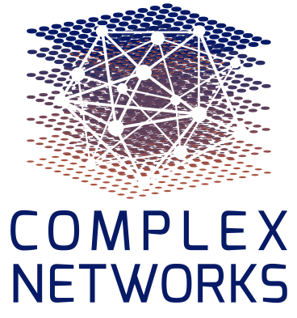
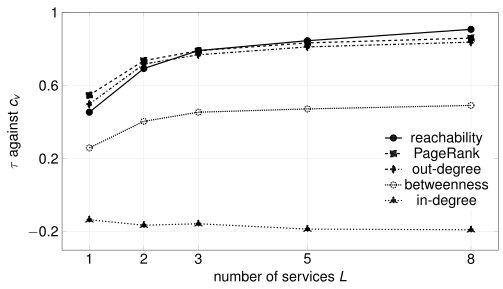

---
# CNA 2026 talk for VitalityForInterdependentNetworks.tex. Every number on these
# slides is copied from the paper (the Fig. 2 table, Table 1, and the text of Sec. 5);
# nothing is computed here. Colours are the brand ramps of docs/brand.md written as
# oklch, so the deck carries no hex literal. Render and export: see README.md.
pagetitle: "Series and Parallel Dependency Links (CNA 2026)"
lang: en
format:
  revealjs:
    width: 1280
    height: 720
    margin: 0.04
    center: false
    transition: none
    background-transition: none
    controls: false
    progress: false
    menu: false
    slide-number: c/t
    hash-type: number
    embed-resources: true
    pdf-max-pages-per-slide: 1
    include-in-header:
      - text: |
          <style>
          :root {
            --ink:       oklch(21% 0 0);
            --ink2:      oklch(44.2% 0 0);
            --muted:     oklch(55.2% 0 0);
            --faint:     oklch(70.5% 0 0);
            --line:      oklch(87.1% 0 0);
            --soft:      oklch(96.7% 0 0);
            --acc:       oklch(48.8% 0.079 210);
            --acc-soft:  oklch(97% 0.01 210);
            --ok:        oklch(72.3% 0.171 150);
            --fail:      oklch(57.7% 0.191 28);
          }
          html, body, .reveal, .reveal-viewport { background: white; }
          .reveal { font-family: Arial, Helvetica, sans-serif; color: var(--ink); }
          .reveal .slides section { font-size: 26px; line-height: 1.3; text-align: left; }
          .reveal .slides section h2 {
            font-family: Arial, Helvetica, sans-serif; font-size: 38px; font-weight: 700;
            color: var(--ink); line-height: 1.15; letter-spacing: -0.01em;
            margin: 0 0 22px 0; text-transform: none;
          }
          .reveal .slide-number { font-family: Arial, Helvetica, sans-serif; font-size: 16px;
            color: var(--muted); background: transparent; }
          .reveal svg text { font-family: Arial, Helvetica, sans-serif; }
          .reveal sub { font-size: 0.65em; vertical-align: -0.3em; }
          .acc { color: var(--acc); }
          .muted { color: var(--ink2); }
          .small { font-size: 22px; }

          /* SVG vocabulary */
          .box      { fill: white; stroke: var(--ink); stroke-width: 2; }
          .node     { fill: white; stroke: var(--ink); stroke-width: 2.5; }
          .node-acc { fill: var(--acc-soft); stroke: var(--acc); stroke-width: 3; }
          .ghost    { fill: white; stroke: var(--muted); stroke-width: 2; stroke-dasharray: 6 5; }
          .rule     { stroke: var(--line); stroke-width: 2; }
          .grid     { stroke: var(--line); stroke-width: 1.5; }
          .edge     { stroke: var(--ink2); stroke-width: 2.5; fill: none; }
          .edge-faint { stroke: var(--faint); stroke-width: 2; fill: none; stroke-dasharray: 6 5; }
          .head     { fill: var(--ink2); }
          .bar      { fill: var(--acc); }
          .ln-acc   { stroke: var(--acc); stroke-width: 4; fill: none; }
          .ln-ctx   { stroke: var(--faint); stroke-width: 2.5; fill: none; }
          .dot-acc  { fill: var(--acc); }
          .t      { font-size: 20px; fill: var(--ink); }
          .t-b    { font-size: 22px; font-weight: 700; fill: var(--ink); }
          .t-big  { font-size: 28px; font-weight: 700; fill: var(--ink); }
          .t-m    { font-size: 18px; fill: var(--ink2); }
          .t-acc  { fill: var(--acc); }
          .c      { text-anchor: middle; }
          .e      { text-anchor: end; }
          .g-ok   { fill: var(--ok); }
          .g-fail { fill: var(--fail); }
          .g-x    { stroke: white; stroke-width: 3; stroke-linecap: round; }

          /* Title slide */
          .title-wrap { position: relative; height: 640px; }
          .logo { position: absolute; top: 0; right: 0; height: 160px; }
          .kicker { padding-top: 40px; font-size: 20px; font-weight: 700; letter-spacing: 0.06em;
            color: var(--acc); text-transform: uppercase; }
          .ptitle { margin-top: 110px; max-width: 1000px; font-size: 50px; font-weight: 700;
            line-height: 1.15; color: var(--ink); }
          .psub { margin-top: 30px; font-size: 30px; color: var(--acc); }
          .accent-rule { margin-top: 42px; width: 120px; height: 5px; background: var(--acc); }
          .authors { margin-top: 30px; font-size: 30px; font-weight: 700; }
          .affil { margin-top: 8px; font-size: 24px; color: var(--ink2); }

          /* Panes and banners */
          .two-col { display: grid; grid-template-columns: 1fr 1fr; gap: 50px; }
          .pane { border-top: 5px solid var(--ink2); padding-top: 14px; }
          .pane-h { font-size: 32px; font-weight: 700; }
          .pane-d { font-size: 27px; margin: 6px 0 2px; }
          .pane-eg { font-size: 20px; color: var(--ink2); }
          .banner { margin-top: 20px; padding: 16px 24px; border-left: 6px solid var(--ink);
            background: var(--soft); font-size: 29px; font-weight: 700; }
          .banner-acc { margin-top: 20px; padding: 16px 24px; border-left: 6px solid var(--acc);
            background: var(--acc-soft); font-size: 29px; }

          /* Formula column + diagram */
          .split { display: grid; grid-template-columns: 1fr 560px; gap: 30px; align-items: center; }
          .defs p { margin: 0 0 24px; font-size: 28px; }
          .defs .lab { display: block; font-size: 18px; font-weight: 700; letter-spacing: 0.06em;
            color: var(--ink2); text-transform: uppercase; margin-bottom: 2px; }
          .eq { font-size: 30px; }
          .eq-big { font-size: 34px; }
          .prop { margin-top: 10px; padding: 14px 22px; border-left: 6px solid var(--acc);
            background: var(--acc-soft); font-size: 26px; }

          /* Benchmark protocol list */
          .reveal ul.proto { list-style: none; margin: 0; padding: 0; }
          .reveal ul.proto li { list-style: none; font-size: 27px; margin: 0 0 18px; padding-left: 22px; border-left: 4px solid var(--line); }
          .proto li b { color: var(--ink); }

          /* Stat tiles */
          .tiles { display: grid; grid-template-columns: 1fr 1fr; gap: 50px; margin-top: 40px; }
          .tile { border-top: 5px solid var(--acc); padding-top: 12px; }
          .tile .num { font-size: 110px; font-weight: 700; color: var(--acc); line-height: 1.05; }
          .tile .lab { font-size: 30px; }
          .tile .sub { font-size: 24px; color: var(--ink2); margin-top: 6px; }
          .strip { margin-top: 60px; padding: 18px 24px; background: var(--soft); font-size: 29px; }

          /* Side panel next to charts */
          .side { display: grid; grid-template-columns: 760px 1fr; gap: 34px; align-items: start; }
          .side9 { display: grid; grid-template-columns: 860px 1fr; gap: 24px; align-items: start; }
          .callout { border-top: 4px solid var(--ink2); padding-top: 10px; margin-bottom: 30px; }
          .callout .num { font-size: 56px; font-weight: 700; color: var(--acc); line-height: 1.1; }
          .callout .lab { font-size: 23px; }
          .callout .h { font-size: 22px; font-weight: 700; color: var(--ink2); }

          /* Applies / stops */
          .est { display: grid; grid-template-columns: 1fr 1fr; gap: 44px; }
          .est h3 { font-size: 34px; font-weight: 700; margin: 0 0 14px; padding-bottom: 8px;
            text-transform: none; font-family: Arial, Helvetica, sans-serif; }
          .est .yes h3 { color: var(--acc); border-bottom: 4px solid var(--acc); }
          .est .no h3  { color: var(--ink); border-bottom: 4px solid var(--ink2); }
          .est .it { margin-bottom: 30px; font-size: 29px; }
          .est .it b { display: block; font-size: 31px; }

          /* Takeaway */
          .take { font-size: 42px; font-weight: 700; line-height: 1.25; max-width: 1140px;
            border-left: 8px solid var(--acc); padding-left: 26px; margin: 10px 0 34px; }
          .end { display: grid; grid-template-columns: 1fr 250px; gap: 40px; align-items: start; }
          .three { display: grid; grid-template-columns: repeat(3, 1fr); gap: 26px; }
          .three div { border-top: 4px solid var(--ink2); padding-top: 12px; font-size: 26px; }
          .links { margin-top: 36px; font-size: 25px; line-height: 1.5; }
          .links code { font-family: Arial, Helvetica, sans-serif; color: var(--acc); background: none; font-size: 25px; }
          .closing { margin-top: 26px; font-size: 27px; color: var(--ink2); }
          .qr { text-align: center; font-size: 19px; color: var(--ink2); }
          .qr img { display: block; width: 230px; height: 230px; margin: 0 auto 6px; }
          /* Loop diagram */
          .edge-dash { stroke: var(--faint); stroke-width: 2; fill: none; stroke-dasharray: 6 5; }
          .t-fail { fill: var(--fail); }

          /* Ranking slide */
          .rank { display: grid; grid-template-columns: 330px 1fr; gap: 30px; align-items: center; }
          .fig2 { margin: 0; }
          .fig2 img { display: block; width: 100%; }
          .fig2 figcaption { font-size: 19px; color: var(--ink2); text-align: center; margin-top: 4px; }

          /* Applies / limitation slide */
          .est2 { display: grid; grid-template-columns: 1fr 600px; gap: 40px; }
          .est2 h3 { font-size: 30px; font-weight: 700; margin: 0 0 12px; padding-bottom: 6px;
            text-transform: none; font-family: Arial, Helvetica, sans-serif; }
          .est2 .yes h3 { color: var(--acc); border-bottom: 4px solid var(--acc); }
          .est2 .no h3  { color: var(--ink); border-bottom: 4px solid var(--ink2); }
          .est2 .it { margin-bottom: 22px; font-size: 25px; }
          .est2 .it b { display: block; font-size: 28px; }
          .lim { font-size: 23px; margin-top: 4px; }
          .beyond { margin-top: 34px; font-size: 25px; }
          .two { display: grid; grid-template-columns: 1fr 1fr; gap: 26px; }
          .two div { border-top: 4px solid var(--ink2); padding-top: 12px; font-size: 26px; }
          </style>
---

## {.title-slide-custom}

```{=html}
<div class="title-wrap">
  
  <div class="kicker">Complex Networks and Their Applications 2026</div>
  <div class="ptitle">Series and Parallel Dependency Links: Vitality for Interdependent Networks of Networks</div>
  <div class="psub">What a link delivers decides how failure spreads</div>
  <div class="accent-rule"></div>
  <div class="authors">Cristian Curaba and Stefano Grimaz</div>
  <div class="affil">University of Udine, Udine, Italy</div>
</div>
```

::: {.notes}
**0:40 · total 0:40**

*Hook: two pictures, same shape, different fate.*

Open: Good morning.

- **Same shape. Yet in one picture the hospital stops when it loses a link, and in the other it survives.**

Full text: script.md
:::

## The service a link carries decides its reading

```{=html}
<svg viewBox="0 0 1180 330" width="1180" height="330" role="img" aria-label="Same topology twice. Left: the grid supplies electricity and the waterworks supply water to a hospital, a series system. Right: the grid and a generator both supply electricity to the hospital, a parallel system.">
  <defs><marker id="m3" viewBox="0 0 10 10" refX="9" refY="5" markerUnits="userSpaceOnUse" markerWidth="15" markerHeight="15" orient="auto"><path d="M0,0 L10,5 L0,10 z" class="head"/></marker></defs>
  <line x1="170" y1="70" x2="386" y2="140" class="edge" marker-end="url(#m3)"/>
  <line x1="170" y1="230" x2="386" y2="160" class="edge" marker-end="url(#m3)"/>
  <rect x="0" y="45" width="170" height="50" rx="8" class="box"/><text x="85" y="77" class="t-b c">Grid</text>
  <rect x="0" y="205" width="170" height="50" rx="8" class="box"/><text x="85" y="237" class="t-b c">Waterworks</text>
  <rect x="222" y="94" width="112" height="28" fill="white"/><text x="278" y="113" class="t c">electricity</text>
  <rect x="240" y="184" width="76" height="28" fill="white"/><text x="278" y="203" class="t c">water</text>
  <rect x="390" y="125" width="150" height="50" rx="8" class="node-acc"/><text x="465" y="157" class="t-b c">Hospital</text>
  <text x="270" y="300" class="t-big c">Series</text>
  <text x="270" y="326" class="t-m c">either loss stops the hospital</text>

  <line x1="590" y1="10" x2="590" y2="320" class="rule"/>

  <line x1="790" y1="70" x2="1006" y2="140" class="edge" marker-end="url(#m3)"/>
  <line x1="790" y1="230" x2="1006" y2="160" class="edge" marker-end="url(#m3)"/>
  <rect x="620" y="45" width="170" height="50" rx="8" class="box"/><text x="705" y="77" class="t-b c">Grid</text>
  <rect x="620" y="205" width="170" height="50" rx="8" class="box"/><text x="705" y="237" class="t-b c">Generator</text>
  <rect x="842" y="94" width="112" height="28" fill="white"/><text x="898" y="113" class="t c">electricity</text>
  <rect x="842" y="184" width="112" height="28" fill="white"/><text x="898" y="203" class="t c">electricity</text>
  <rect x="1010" y="125" width="150" height="50" rx="8" class="node-acc"/><text x="1085" y="157" class="t-b c">Hospital</text>
  <text x="890" y="300" class="t-big c">Parallel</text>
  <text x="890" y="326" class="t-m c">the hospital survives either loss</text>
</svg>
<div class="banner-acc"><b>Links with the same service</b> are alternatives. <b>Links with different services</b> are jointly required.</div>
<div class="small muted" style="margin-top:10px">Same graph topology on both sides: no topology index can tell them apart.</div>
```

::: {.notes}
**1:05 · total 1:45**

*Hook: electricity and water; grid and generator; the sentence.*

Open: Here are the two pictures.

- **Links with the same service are alternatives. Links with different services are jointly required.**

Full text: script.md
:::

## Dependency links are read two ways

```{=html}
<div class="two-col">
  <div class="pane">
    <div class="pane-h">Series</div>
    <div class="pane-d">Failure travels along every link</div>
    <div class="pane-eg">Buldyrev 2010 · Parshani 2011 · Bashan 2011</div>
    <svg viewBox="0 0 520 220" width="520" height="220" role="img" aria-label="Two suppliers feed an AND gate into one node.">
      <defs><marker id="m2a" viewBox="0 0 10 10" refX="9" refY="5" markerUnits="userSpaceOnUse" markerWidth="15" markerHeight="15" orient="auto"><path d="M0,0 L10,5 L0,10 z" class="head"/></marker></defs>
      <circle cx="70" cy="60" r="24" class="node"/>
      <circle cx="70" cy="170" r="24" class="node"/>
      <line x1="94" y1="68" x2="222" y2="106" class="edge" marker-end="url(#m2a)"/>
      <line x1="94" y1="162" x2="222" y2="124" class="edge" marker-end="url(#m2a)"/>
      <polygon points="260,69 306,115 260,161 214,115" class="box"/>
      <text x="260" y="123" class="t-b c">AND</text>
      <line x1="306" y1="115" x2="380" y2="115" class="edge" marker-end="url(#m2a)"/>
      <circle cx="410" cy="115" r="26" class="node"/>
      <text x="410" y="190" class="t-m c">either loss stops it</text>
    </svg>
  </div>
  <div class="pane">
    <div class="pane-h">Parallel</div>
    <div class="pane-d">One working supplier suffices</div>
    <div class="pane-eg">Shao 2011</div>
    <svg viewBox="0 0 520 220" width="520" height="220" role="img" aria-label="Two suppliers feed an OR gate into one node.">
      <defs><marker id="m2b" viewBox="0 0 10 10" refX="9" refY="5" markerUnits="userSpaceOnUse" markerWidth="15" markerHeight="15" orient="auto"><path d="M0,0 L10,5 L0,10 z" class="head"/></marker></defs>
      <circle cx="70" cy="60" r="24" class="node"/>
      <circle cx="70" cy="170" r="24" class="node"/>
      <line x1="94" y1="68" x2="222" y2="106" class="edge" marker-end="url(#m2b)"/>
      <line x1="94" y1="162" x2="222" y2="124" class="edge" marker-end="url(#m2b)"/>
      <polygon points="260,69 306,115 260,161 214,115" class="box"/>
      <text x="260" y="123" class="t-b c">OR</text>
      <line x1="306" y1="115" x2="380" y2="115" class="edge" marker-end="url(#m2b)"/>
      <circle cx="410" cy="115" r="26" class="node"/>
      <text x="410" y="190" class="t-m c">survives either loss</text>
    </svg>
  </div>
</div>
<div class="banner">Each model applies one reading to every link.</div>
```

::: {.notes}
**1:05 · total 2:50**

*Hook: series, parallel, one reading for every link.*

Open: The literature on networks of networks knows both behaviours.

- **series**
- **parallel**
- **The service each link carries decides which reading it gets.**

Full text: script.md
:::

## One label per node; the propagation rule follows

```{=html}
<div class="split">
<div class="defs">
  <p><span class="lab">Label</span>σ(v): the service v provides</p>
  <p><span class="lab">Requirements, read off the links</span><span class="eq">S<sub>req</sub>(v) = { σ(u) : u → v }</span></p>
  <p><span class="lab">Suppliers of s to v</span><span class="eq">P<sub>s</sub>(v)</span></p>
  <p><span class="lab">Rule</span><span class="eq-big">f<sub>n+1</sub>(v) = f<sub>n</sub>(v) ∧ ⋀<sub>s</sub> ⋁<sub>u ∈ P<sub>s</sub>(v)</sub> f<sub>n</sub>(u)</span></p>
  <p class="muted small">Monotone: fixed point within |V| rounds.</p>
</div>
<svg viewBox="0 0 560 360" width="560" height="360" role="img" aria-label="Gate view: grid and generator feed an OR for electricity, the waterworks feed an OR for water, and both ORs feed an AND into the hospital.">
  <defs><marker id="m4" viewBox="0 0 10 10" refX="9" refY="5" markerUnits="userSpaceOnUse" markerWidth="15" markerHeight="15" orient="auto"><path d="M0,0 L10,5 L0,10 z" class="head"/></marker></defs>
  <rect x="0" y="40" width="150" height="48" rx="8" class="box"/><text x="75" y="71" class="t-b c">Grid</text>
  <text x="75" y="108" class="t-m c">electricity</text>
  <rect x="0" y="128" width="150" height="48" rx="8" class="box"/><text x="75" y="159" class="t-b c">Generator</text>
  <text x="75" y="196" class="t-m c">electricity</text>
  <rect x="0" y="256" width="150" height="48" rx="8" class="box"/><text x="75" y="287" class="t-b c">Waterworks</text>
  <text x="75" y="324" class="t-m c">water</text>
  <line x1="150" y1="64" x2="199" y2="99" class="edge" marker-end="url(#m4)"/>
  <line x1="150" y1="152" x2="199" y2="111" class="edge" marker-end="url(#m4)"/>
  <line x1="150" y1="280" x2="191" y2="280" class="edge" marker-end="url(#m4)"/>
  <polygon points="235,67 273,105 235,143 197,105" class="box"/><text x="235" y="112" class="t-b c">OR</text>
  <polygon points="235,242 273,280 235,318 197,280" class="box"/><text x="235" y="287" class="t-b c">OR</text>
  <text x="235" y="56" class="t-m c">electricity</text>
  <text x="235" y="340" class="t-m c">water</text>
  <line x1="259" y1="119" x2="353" y2="175" class="edge" marker-end="url(#m4)"/>
  <line x1="259" y1="266" x2="353" y2="211" class="edge" marker-end="url(#m4)"/>
  <polygon points="385,147 431,193 385,239 339,193" class="box"/><text x="385" y="200" class="t-b c">AND</text>
  <line x1="431" y1="193" x2="451" y2="193" class="edge" marker-end="url(#m4)"/>
  <rect x="455" y="168" width="105" height="50" rx="8" class="node-acc"/><text x="507.5" y="200" class="t-b c">Hospital</text>
</svg>
</div>
```

::: {.notes}
**1:20 · total 4:10**

*Hook: one label; requirements from the links; OR within, AND across.*

Open: Turning the observation into a model takes very little.

- **Within a group, OR: one working supplier is enough. Across groups, AND: you need every service.**

Full text: script.md
:::

## Vitality: the operativity lost when a node goes

```{=html}
<div class="split">
<div class="defs">
  <p><span class="lab">Vitality index</span><span class="eq-big">c<sub>v</sub> = ( N(D) − N(D ⊖ v) ) / |V|</span></p>
  <p class="muted">N: nodes left operational · Ω: mean of c<sub>v</sub>, the Mean Operativity Loss</p>
  <div class="prop"><b>Proposition.</b> Removing v = switching v off:<br>N(D ⊖ v) = N<sub>f<sub>0</sub>(v)=0</sub>(D)</div>
</div>
<svg viewBox="0 0 560 360" width="560" height="360" role="img" aria-label="After removing the grid, the hospital still requires electricity, has no electricity supplier left, and fails.">
  <defs><marker id="m5" viewBox="0 0 10 10" refX="9" refY="5" markerUnits="userSpaceOnUse" markerWidth="15" markerHeight="15" orient="auto"><path d="M0,0 L10,5 L0,10 z" class="head"/></marker></defs>
  <text x="0" y="28" class="t-b">Requirements stay when a node goes</text>
  <rect x="0" y="80" width="150" height="54" rx="8" class="ghost"/><text x="75" y="114" class="t-b c" fill="var(--muted)">Grid</text>
  <text x="75" y="158" class="t-m c">electricity</text>
  <circle cx="150" cy="80" r="14" class="g-fail"/><path d="M144,74 L156,86 M156,74 L144,86" class="g-x"/>
  <text x="172" y="76" class="t-m">removed</text>
  <rect x="0" y="210" width="150" height="54" rx="8" class="box"/><text x="75" y="244" class="t-b c">Waterworks</text>
  <text x="75" y="288" class="t-m c">water</text>
  <line x1="150" y1="112" x2="367" y2="162" class="edge-faint"/>
  <line x1="150" y1="232" x2="368" y2="178" class="edge" marker-end="url(#m5)"/>
  <circle cx="410" cy="170" r="40" class="g-fail"/>
  <path d="M396,156 L424,184 M424,156 L396,184" class="g-x"/>
  <text x="410" y="240" class="t c">the hospital still requires</text>
  <text x="410" y="266" class="t c">electricity: no supplier left</text>
  <text x="410" y="294" class="t c" font-weight="700">→ the hospital fails</text>
  <text x="0" y="350" class="t-m">Re-deriving requirements instead: every node scores 1/|V|</text>
</svg>
</div>
```

::: {.notes}
**1:15 · total 5:25**

*Hook: take it away; others remember; removing = switching off.*

Open: Now, which nodes matter most?

- **Take a node away, and measure what the network loses.**
- **So the vitality of a node is what the model reports when that single node fails.**

Full text: script.md
:::

## One fixed graph; only the labels change

```{=html}
<div class="split" style="grid-template-columns: 640px 1fr;">
<svg viewBox="0 0 640 330" width="640" height="330" role="img" aria-label="The same six-node acyclic graph drawn twice: with one service label everywhere, and with three different service labels.">
  <defs><marker id="m6" viewBox="0 0 10 10" refX="23" refY="5" markerUnits="userSpaceOnUse" markerWidth="15" markerHeight="15" orient="auto"><path d="M0,0 L10,5 L0,10 z" class="head"/></marker></defs>
  <g>
    <line x1="30" y1="60" x2="120" y2="130" class="edge" marker-end="url(#m6)"/>
    <line x1="30" y1="200" x2="120" y2="130" class="edge" marker-end="url(#m6)"/>
    <line x1="30" y1="60" x2="210" y2="60" class="edge" marker-end="url(#m6)"/>
    <line x1="120" y1="130" x2="210" y2="60" class="edge" marker-end="url(#m6)"/>
    <line x1="120" y1="130" x2="210" y2="200" class="edge" marker-end="url(#m6)"/>
    <line x1="30" y1="200" x2="210" y2="200" class="edge" marker-end="url(#m6)"/>
    <line x1="210" y1="60" x2="280" y2="130" class="edge" marker-end="url(#m6)"/>
    <line x1="210" y1="200" x2="280" y2="130" class="edge" marker-end="url(#m6)"/>
    <circle cx="30" cy="60" r="20" class="node"/><text x="30" y="67" class="t-b c">A</text>
    <circle cx="30" cy="200" r="20" class="node"/><text x="30" y="207" class="t-b c">A</text>
    <circle cx="120" cy="130" r="20" class="node"/><text x="120" y="137" class="t-b c">A</text>
    <circle cx="210" cy="60" r="20" class="node"/><text x="210" y="67" class="t-b c">A</text>
    <circle cx="210" cy="200" r="20" class="node"/><text x="210" y="207" class="t-b c">A</text>
    <circle cx="280" cy="130" r="20" class="node"/><text x="280" y="137" class="t-b c">A</text>
    <text x="155" y="270" class="t-b c">L = 1</text>
    <text x="155" y="296" class="t-m c">parallel</text>
  </g>
  <g transform="translate(340,0)">
    <line x1="30" y1="60" x2="120" y2="130" class="edge" marker-end="url(#m6)"/>
    <line x1="30" y1="200" x2="120" y2="130" class="edge" marker-end="url(#m6)"/>
    <line x1="30" y1="60" x2="210" y2="60" class="edge" marker-end="url(#m6)"/>
    <line x1="120" y1="130" x2="210" y2="60" class="edge" marker-end="url(#m6)"/>
    <line x1="120" y1="130" x2="210" y2="200" class="edge" marker-end="url(#m6)"/>
    <line x1="30" y1="200" x2="210" y2="200" class="edge" marker-end="url(#m6)"/>
    <line x1="210" y1="60" x2="280" y2="130" class="edge" marker-end="url(#m6)"/>
    <line x1="210" y1="200" x2="280" y2="130" class="edge" marker-end="url(#m6)"/>
    <circle cx="30" cy="60" r="20" class="node"/><text x="30" y="67" class="t-b c">A</text>
    <circle cx="30" cy="200" r="20" class="node"/><text x="30" y="207" class="t-b c">B</text>
    <circle cx="120" cy="130" r="20" class="node"/><text x="120" y="137" class="t-b c">C</text>
    <circle cx="210" cy="60" r="20" class="node"/><text x="210" y="67" class="t-b c">A</text>
    <circle cx="210" cy="200" r="20" class="node"/><text x="210" y="207" class="t-b c">B</text>
    <circle cx="280" cy="130" r="20" class="node"/><text x="280" y="137" class="t-b c">C</text>
    <text x="155" y="270" class="t-b c">L = 3</text>
    <text x="155" y="296" class="t-m c">toward series</text>
  </g>
</svg>
<ul class="proto">
  <li>Random acyclic graph: <b>60 nodes, ~109 links</b>, held fixed</li>
  <li><b>L ∈ {1, 2, 3, 5, 8}</b> services</li>
  <li><b>20 replicates</b></li>
  <li>Against: reachability, PageRank, in-/out-degree, betweenness</li>
  <li>Overlap of the top ten percent</li>
</ul>
</div>
```

::: {.notes}
**1:05 · total 6:30**

*Hook: freeze the graph; change L; five classic indices.*

Open: Now the experiment.

- **we freeze the graph topology.**

Full text: script.md
:::

## The labels alone move the Mean Operativity Loss fivefold

```{=html}
<div class="side">
<svg viewBox="0 0 760 420" width="760" height="420" role="img" aria-label="Mean Operativity Loss by number of services L: 0.023 at L=1, 0.049 at 2, 0.072 at 3, 0.097 at 5, 0.114 at 8.">
  <line x1="100" y1="340" x2="720" y2="340" class="grid"/>
  <line x1="100" y1="223.3" x2="720" y2="223.3" class="grid"/>
  <line x1="100" y1="106.7" x2="720" y2="106.7" class="grid"/>
  <text x="90" y="346" class="t-m e">0</text>
  <text x="90" y="229" class="t-m e">5%</text>
  <text x="90" y="113" class="t-m e">10%</text>
  <text x="30" y="220" class="t-m c" transform="rotate(-90 30 220)">Mean Operativity Loss</text>
  <path d="M120,340 V290.3 a4,4 0 0 1 4,-4 H196 a4,4 0 0 1 4,4 V340 Z" class="bar"/>
  <path d="M240,340 V229.7 a4,4 0 0 1 4,-4 H316 a4,4 0 0 1 4,4 V340 Z" class="bar"/>
  <path d="M360,340 V176 a4,4 0 0 1 4,-4 H436 a4,4 0 0 1 4,4 V340 Z" class="bar"/>
  <path d="M480,340 V117.7 a4,4 0 0 1 4,-4 H556 a4,4 0 0 1 4,4 V340 Z" class="bar"/>
  <path d="M600,340 V78 a4,4 0 0 1 4,-4 H676 a4,4 0 0 1 4,4 V340 Z" class="bar"/>
  <text x="160" y="276" class="t c">2.3%</text>
  <text x="280" y="215" class="t c">4.9%</text>
  <text x="400" y="162" class="t c">7.2%</text>
  <text x="520" y="104" class="t c">9.7%</text>
  <text x="640" y="64" class="t c" font-weight="700">11.4%</text>
  <text x="160" y="368" class="t c">1</text>
  <text x="280" y="368" class="t c">2</text>
  <text x="400" y="368" class="t c">3</text>
  <text x="520" y="368" class="t c">5</text>
  <text x="640" y="368" class="t c">8</text>
  <text x="160" y="392" class="t-m c">parallel</text>
  <text x="640" y="392" class="t-m c">near-series</text>
  <text x="410" y="414" class="t-m c">L: number of services</text>
</svg>
<div>
  <div class="callout">
    <div class="num">fivefold</div>
    <div class="lab">from about 2% to over 11% of the network, same graph</div>
  </div>
  <div class="callout">
    <div class="h">Every topology index</div>
    <div class="lab">identical at every L</div>
  </div>
</div>
</div>
```

::: {.notes}
**1:10 · total 7:40**

*Hook: 0.023, 0.114, five times; topology stays still.*

Open: Here is what the labels alone do.

- **Same graph. Only the labels change. Five times the loss.**

Full text: script.md
:::

## Relabelling reshuffles the nodes worth protecting

```{=html}
<div class="rank">
  <div class="tile">
    <div class="num">3 / 5</div>
    <div class="lab">of the top ten percent nodes change</div>
    <div class="sub">same graph, L = 1 vs L = 8</div>
  </div>
  <figure class="fig2">
    
    <figcaption>Agreement of five topology indices with vitality as L grows, same graph (paper, Fig. 2)</figcaption>
  </figure>
</div>
<div class="banner">Same graph. Only the labels change.</div>
```

::: {.notes}
**1:35 · total 9:15**

*Hook: three in five; the paper's figure; every line moves.*

Open: The ranking moves as well, and this is what matters for protection.

- **Relabelling replaces three in every five of them.**
- **How well a topology index ranks node importance depends on labels it never reads.**

Full text: script.md
:::

## Where it applies, and its core limitation

```{=html}
<div class="est2">
  <div class="yes">
    <h3>Applies</h3>
    <div class="it"><b>Interconnected services</b>pumping station: power AND telemetry; district: either reservoir</div>
    <div class="it"><b>Sociotechnical systems</b>staff AND software; either on-call operator</div>
    <div class="banner-acc beyond"><b>Beyond vitality:</b> failure propagation runs from any initial state, so different scenarios can be explored.</div>
  </div>
  <div class="no">
    <h3>Core limitation: local support</h3>
    <svg viewBox="0 0 600 250" width="600" height="250" role="img" aria-label="A failed reservoir feeds a junction, which fails too; that junction feeds a ring of three junctions that pass water to each other. Each ring junction still sees a working supplier, so the model keeps the ring operational.">
      <defs><marker id="mr" viewBox="0 0 10 10" refX="21" refY="5" markerUnits="userSpaceOnUse" markerWidth="15" markerHeight="15" orient="auto"><path d="M0,0 L10,5 L0,10 z" class="head"/></marker></defs>
      <circle cx="35" cy="125" r="24" class="g-fail"/>
      <text x="0" y="185" class="t">reservoir</text>
      <line x1="60" y1="125" x2="125" y2="125" class="edge-dash" marker-end="url(#mr)"/>
      <line x1="125" y1="125" x2="215" y2="125" class="edge-dash" marker-end="url(#mr)"/>
      <line x1="215" y1="125" x2="320" y2="45" class="edge" marker-end="url(#mr)"/>
      <line x1="320" y1="45" x2="320" y2="205" class="edge" marker-end="url(#mr)"/>
      <line x1="320" y1="205" x2="215" y2="125" class="edge" marker-end="url(#mr)"/>
      <circle cx="125" cy="125" r="22" class="g-fail"/>
      <circle cx="215" cy="125" r="24" class="g-ok"/>
      <circle cx="320" cy="45" r="24" class="g-ok"/>
      <circle cx="320" cy="205" r="24" class="g-ok"/>
      <text x="284" y="132" class="t c">water</text>
      <text x="370" y="96" class="t-b">Model:</text>
      <text x="370" y="124" class="t-b" font-weight="400">ring operational</text>
      <text x="370" y="172" class="t-b t-fail">Reality:</text>
      <text x="370" y="200" class="t-b" font-weight="400">no water enters</text>
    </svg>
    <div class="lim">Each junction sees a working supplier, so the ring holds itself up. <b>Fix: trace each service to its source, with a flow-based propagation.</b></div>
  </div>
</div>
```

::: {.notes}
**1:45 · total 11:00**

*Hook: pumping station, district, sociotechnical; any initial state; the ring that holds itself up.*

Open: This model can be effectively applied wherever you have heterogeneous services, dependency links and a notion of failure.

- **Every junction sees a working supplier, so the ring holds itself up**
- **Tracing a service back to its source needs quantities carried along the links: a flow-based propagation.**

Full text: script.md
:::

## Describe what each node provides

```{=html}
<div class="take">The description of an interdependent network of networks should carry the service each node provides.</div>
<div class="end">
<div>
<div class="two">
  <div>Labels group suppliers into alternatives and joint requirements</div>
  <div>On a fixed topology, as the number of service labels grows, the Mean Operativity Loss rises fivefold and three fifths of the top ten percent nodes change</div>
</div>
<div class="links">
  Repository&nbsp; <code>github.com/cascade-platform-org/CASCADE</code><br>
  Platform&nbsp;&nbsp;&nbsp;&nbsp; <code>app.cascade-platform.org</code>
</div>
<div class="closing">Questions welcome.</div>
</div>
<div class="qr">Try the platform</div>
</div>
```

::: {.notes}
**1:00 · total 12:00**

*Hook: write down what each node provides.*

Open: **Links with the same service are alternatives.

- **Links with the same service are alternatives. Links with different services are jointly required.**
- **When you describe an interdependent network of networks, write down what each node provides.**

Full text: script.md
:::
